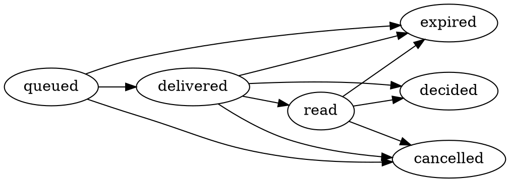

# Beeper — the pager is back, for your AI agents

> **One line. One code. One tap.** Your coding agents page you only when a human
> decision is actually required, and you approve or refuse from a pager.

Tuesday, 11 pm. You launched three agents before dinner. The first one has been
waiting since 19:12 for a `git push` confirmation nobody saw. The second one ran
in full-trust mode and rewrote a folder it should not have touched. The third one
finished three hours ago and nobody knows.

Three distinct failures: **invisible waiting**, **blind trust**, **noise**.
A pager answers all three, and it already answered them in 1995: SNPP level 3
([RFC 1861](https://www.rfc-editor.org/rfc/rfc1861.txt)) describes multiple-choice
replies seeded by the sender, read acknowledgement, expiry and message tagging.
Beeper resurrects that protocol as the attention layer between agents and the
human on call.

Built for [Kiroween 2026](https://kiroween.devpost.com/) — **Resurrection** track.

---

## What it does

| Piece | Role |
|---|---|
| **Central** | One Node process, one SQLite file. Receives requests, classifies risk by rules, composes the line, holds the queue, enforces the attention budget, writes an append-only audit log. |
| **Beeper** | An installable PWA that looks and behaves like an alphanumeric pager: 4 rows × 20 columns, three keys, a risk lamp, a memory of the last 50 pages. |
| **Kiro hook** | `bip-hook` plugs into Kiro's `PreToolUse`: it applies local rules first, otherwise it creates a page, blocks the tool and resumes it on approval (exit `0`) or refuses it with a reason (exit `2`). |
| **MCP server** | `page_human`, `page_wait`, `page_cancel` — any MCP client can ask the human, without changing the agent. |
| **SNPP gateway** | A real RFC 1861 two-way transaction over TCP (`2WAY`, `PAGEr`, `MESSage`, `RTYPe`, `MCREsponse`, `ACKRead`, `EXPTag`, `SEND`, `MSTAtus`, `KTAG`). |
| **Crew app** | Relays Kiro Crew approval events to the pager and resolves them from a signed decision. |

### The page line

```
110 fw RUN rm -rf dist/ && pnpm build #a3f9
310 a PUSH main>origin 3 commits +120-14 #07c2
510 b PICK date lib? A dayjs B luxon C temporal #e1d0
610 fw SPEND 400 credits left of 1000, continue? #5b12
911 a STUCK cannot reach registry.npmjs.org (3 tries) #c44e
```

`CODE STATION VERB subject #hhhh` — 80 printable ASCII characters maximum, where
`#hhhh` is the first half-byte of the SHA-256 of the exact payload.

**The honesty rule.** For a tool approval, the line and detail screens 2 and 3
are composed by the Central **from the payload alone** (the command, the path,
the branch, the diff stats). The agent's own prose appears only on screen 4,
labelled `AGENT SAYS:`. You decide on the fact, never on the narrative.

### Risk levels

| Level | Meaning | Gesture |
|---|---|---|
| 🟢 Green | Local and reversible | One tap, possible from the notification |
| 🟠 Amber | Touches the outside world or a wide scope | One tap inside the open pager |
| 🔴 Red | Irreversible or destructive | Pager open + one second press-and-hold |

The level is **computed by rules**, never declared by the agent, and a source can
raise it but never lower it.

### What it is not

Not an orchestrator (it never launches an agent), not a chat (one line, one
answer), not a replacement for Kiro's permission system (it complements it — the
security boundary stays where it is), not a radio (no POCSAG, no hardware), not a
shared SaaS (one instance per person or team, self-hosted).

---

## Run it

Requirements: Node.js ≥ 22.13 (for `node:sqlite`) and pnpm ≥ 10.

```bash
pnpm install
pnpm build
pnpm central              # http://127.0.0.1:8787  — prints a bootstrap station token
pnpm pager                # http://127.0.0.1:5173  — the pager itself (dev)
```

Then, in the repository you want supervised:

```bash
# Kiro hook — .kiro/hooks/bipeur-approve.json ships in this repo
export BIPEUR_URL=http://127.0.0.1:8787
export BIPEUR_TOKEN=<the station token printed by the Central>
npx bip-hook --rules .bipeur/rules.yaml     # reads the hook event on stdin

# or ask a human from any shell script
npx bip ask "Deploy now?" --yes-no --ttl 10m   # exit 0 = yes, 1 = no, 3 = expired

# or from any MCP client
npx bipeur-mcp                                # tools: page_human, page_wait, page_cancel

# or speak 1995 to it
nc 127.0.0.1 4440                             # SNPP session, see docs/SNPP.md
```

Everything is configurable through `.env` (see `.env.example`). One process, one
SQLite file: back it up by copying the file.

## Demo mode

Judges and the curious: no account, no installation, no data kept.

```bash
BIPEUR_DEMO=1 pnpm central      # then open the URL and click "Start demo"
```

The simulator plays three fictional agents (`fw`, `a`, `b`) that emit varied
requests — a `git push`, a destructive `rm -rf`, a design question, a budget
warning, a stuck agent — in a space isolated per visitor and wiped after 24 h.
Open the pager in a second tab or scan the QR code with your phone.

Hosted demo: **see the Devpost submission page** (link added at submission time).

---

## How it is put together

```
Kiro IDE / CLI ── PreToolUse hook ───────┐
Kiro Crew ────── app (event) ────────────┤
MCP client ───── page_human ─────────────┼─ HTTP ─▶ ┌────────────────┐ ◀─ WebSocket ─▶ ┌──────────┐
Scripts ──────── SNPP :4440, bip ────────┘          │    Central     │    Web Push     │  Beeper  │
                                                     │ rules · queue  │ ◀─ signed ────  │  (PWA)   │
                                                     │ audit · SQLite │    decision     └──────────┘
                                                     └────────────────┘
```

| Package | Contents |
|---|---|
| `packages/core` | The shared contract: fingerprint, line composer, rules engine, state machine, attention budget, signed-decision claims. Browser-safe; `@bipeur/core/node` adds hashing and ECDSA verification. |
| `packages/central` | Hono API, `node:sqlite` store, WebSocket stream, Web Push, audit log, simulator, dashboard. |
| `packages/pager` | React + Vite PWA: screen, keys, pairing, signed decisions, offline behaviour. |
| `packages/hook` | `bip-hook`, the Kiro hook, and `bip-notice` for end-of-turn notices. |
| `packages/mcp-server` | `page_human`, `page_wait`, `page_cancel`. |
| `packages/snpp` | RFC 1861 gateway. |
| `packages/cli` | `bip`, for shell scripts. |
| `packages/crew-app` | Kiro Crew app (`app.json`, page, background process). |
| `e2e/` | Playwright scenarios P1…P7 — outside PR CI. |

### Page state machine (BIP-F-05)



Any other transition is refused, and a final state never changes again.

### Signed decisions (BIP-F-18)

The pager generates a non-extractable ECDSA P-256 key pair at pairing time. Every
decision carries the page id, the **fingerprint**, the verdict, a single-use
nonce, a deadline and a signature over exactly those claims. The Central verifies
the signature, the device, the fingerprint equality, the deadline and the absence
of replay before accepting. An approval can therefore never be applied to another
action than the one displayed — the metric *orphan approvals* is zero **by
construction**, and `decision.rejected` events prove it.

### Metrics, all derived from the audit log

| Metric | Definition | Target |
|---|---|---|
| Decision latency | Median between delivery and decision, active hours | < 60 s |
| Filter rate | Share of agent events that never became a page | ≥ 90 % |
| Unblocked time | Sum of the waits an agent would have endured | displayed |
| Orphan approvals | Decisions whose fingerprint does not match the request | 0 |
| Delivery latency | Creation → shown on the pager, p95, local network | < 2 s |

---

## Tests

```bash
pnpm test          # unit tests + property tests (fast-check)
pnpm test:props    # property tests only
pnpm e2e           # Playwright P1…P7 (installs browsers first: pnpm --filter @bipeur/e2e install-browsers)
```

Twelve properties are written down before the code and tested with
[fast-check](https://github.com/dubzzz/fast-check), each with its seed recorded:

| Id | Property |
|---|---|
| BIP-P-01 | The composed line is ≤ 80 printable ASCII characters and ends with `#` + 4 hex chars of the fingerprint |
| BIP-P-02 | Truncation never drops the code, the station or the verb, and keeps the first word of the subject |
| BIP-P-03 | A page only walks the edges of the state graph; a final state is stable |
| BIP-P-04 | A page receives at most one accepted decision, however many arrive concurrently |
| BIP-P-05 | A decision whose fingerprint differs is never accepted |
| BIP-P-06 | A decision received after its deadline never results in an approval |
| BIP-P-07 | Over any sliding hour, delivered green+amber pages never exceed the budget |
| BIP-P-08 | A red page is never held by the budget nor by quiet hours |
| BIP-P-09 | The risk of a composite command is the max of its segments; adding one never lowers it |
| BIP-P-10 | Two requests with the same fingerprint from the same station give one page |
| BIP-P-11 | The SNPP parser answers with an RFC code for any input line and never throws |
| BIP-P-12 | After a simulated stop/restart at any instant, no pending page is lost or duplicated |

---

## Built with Kiro

The whole project is driven by Kiro specs, steering, hooks, custom agents and
Crew. `/.kiro` is tracked on purpose — the `contest-guard` workflow fails if any
`.gitignore` rule ever matches it.

- `.kiro/specs/` — one spec per lot: `central-core`, `pager-pwa`, `kiro-adapters`,
  `snpp-gateway`, `crew-app`, `central-dashboard` (`requirements.md` in EARS
  notation, `design.md`, `tasks.md`).
- `.kiro/steering/` — `product.md`, `tech.md`, `structure.md`, `testing.md`,
  always included; `pager-format.md`, `no-sound.md` always; `security.md`
  (`fileMatch: packages/central/**`) and `rfc1861.md` (`fileMatch: packages/snpp/**`).
- `.kiro/hooks/` — `bipeur-approve` (this repository is supervised by its own
  product), `line-budget`, `state-machine-guard`, `kiro-dir-guard`,
  `journal-reminder`.
- `.kiro/agents/` — `reviewer` (read-only) and `rfc-checker`.
- `.kiro/skills/pager-line/` — writing a line that fits 80 characters.

`KIRO_JOURNAL.md` records, lot by lot, which surface was used and what it
changed. From lot A4 on, the agents building Beeper — and then the agents
building the other projects — are supervised by Beeper itself; the audit log
supplies the numbers quoted in the video.

## CI

GitHub Actions on self-hosted runners, **verdict in 5 minutes maximum**:
`typecheck`, `lint`, `test`, `build` (+ a boot smoke test), `contest-guard`
(Kiroween rules and the < 500 lines / < 50 lines-per-function rule),
`ci-budget` (no job may declare more than 5 minutes), `stale-base-guard`,
`hermes-lite`. Playwright runs outside pull requests. Merges go through the
Mergify queue; conflicts are resolved by the Hermes resolver
(`.github/hermes/`), which falls back to a deterministic strategy and escalates
to a human rather than guessing.

## Dependencies and licences

| Package | Version | Licence | Why |
|---|---|---|---|
| `hono` | ^4 | MIT | Tiny, fast HTTP router for the Central |
| `@hono/node-server` | ^2 | MIT | Node adapter |
| `ws` | ^8 | MIT | WebSocket stream to the pager |
| `web-push` | ^4 | MPL-2.0 | Web Push (BIP-F-19); file-level copyleft, no linking constraint on our code |
| `zod` | ^4 | MIT | Validation of every inbound payload |
| `yaml` | ^2 | ISC | The rules file |
| `react`, `react-dom` | ^19 | MIT | The pager UI |
| `vite`, `@vitejs/plugin-react` | ^8 / ^6 | MIT | Build of the PWA |
| `vite-plugin-pwa` | ^2 | MIT | Service worker + manifest |
| `@modelcontextprotocol/sdk` | ^1 | MIT | The MCP server |
| `vitest`, `fast-check` | ^5 / ^4 | MIT | Unit and property tests |
| `@playwright/test` | ^1 | Apache-2.0 | E2E scenarios, outside PR CI |
| `typescript`, `eslint`, `typescript-eslint` | ^5 / ^9 / ^8 | Apache-2.0 / MIT / BSD-2 | Toolchain |

Deliberately **excluded**: HyperFormula (GPLv3) and TruffleHog (AGPL) — strong
copyleft. Storage uses Node's built-in `node:sqlite` instead of
`better-sqlite3`: same single-file format, no native build, so the container
stays under 200 MB and CI stays inside its budget (BIP-N-09). The store sits
behind an interface if a different driver is ever needed.

Fonts: the matrix font used by the pager is bundled only if its licence is OFL or
equivalent; otherwise the CSS falls back to a monospace stack (see
`docs/ART-DIRECTION.md`).

**Pre-existing code**: none. This repository was created on 11 November 2026,
during the submission window, and every line was written for it. The CI scaffold
(`.github/workflows/ci-budget.yml`, `hermes-lite.yml`, `stale-base-guard.yml`,
`.mergify.yml`) is copied from the author's own open-source scaffold, as the
contest rules require for shared utilities.

## Security and threat model

| Threat | Answer |
|---|---|
| An agent describes a harmless action to get a dangerous one approved | The line is composed by the Central from the payload; agent prose is confined to screen 4 and labelled |
| An approval is replayed or applied to another request | Signed decision binding id + fingerprint + nonce + deadline; the hook re-checks the fingerprint before exiting 0 |
| A third party floods the human with fake pages | One token per station (stored hashed), rate limiting, attention budget, one-gesture revocation |
| The phone is stolen or lent | Red pages require the open app and a one-second hold; device revocation from the Central |
| Page content leaks on the lock screen | Masking setting: only the code and the station are shown |
| Page text tries to manipulate the human or another agent | Page content is data: printable ASCII only, no clickable link except the callback URL declared by the station |
| The Central is down | Hooks fail closed: without a decision, the tool is refused with a clear reason |
| The SNPP gateway is reachable from outside | Loopback by default; `LOGIn` required otherwise |

**No sound, ever, by default.** No agent working on this repository triggers or
listens to a sound; the intent to beep is proved by the `beep.requested` audit
event (BIP-N-06).

## Licence

MIT — see [LICENSE](LICENSE).
